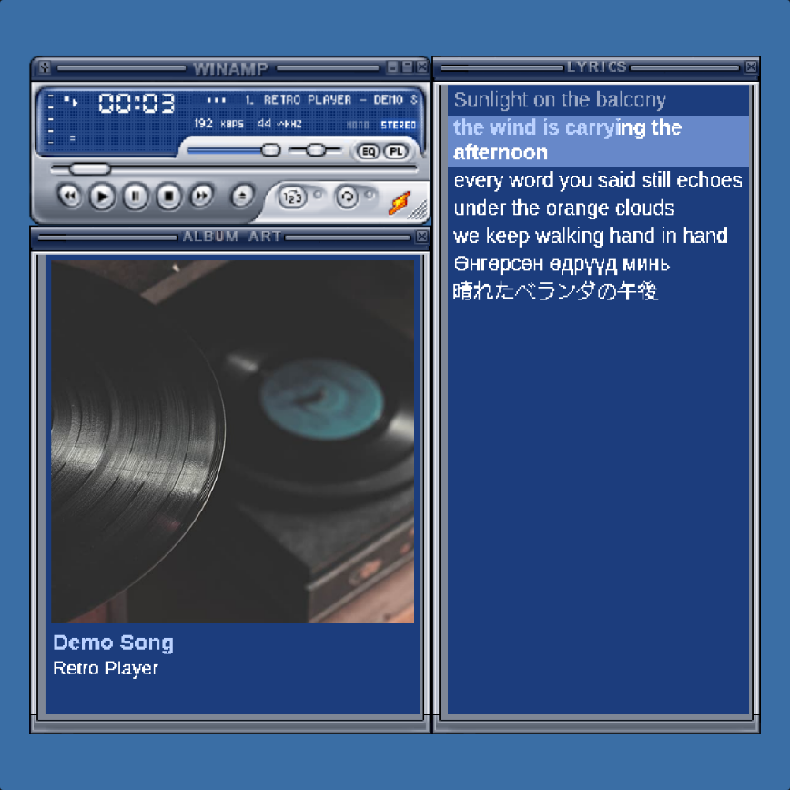
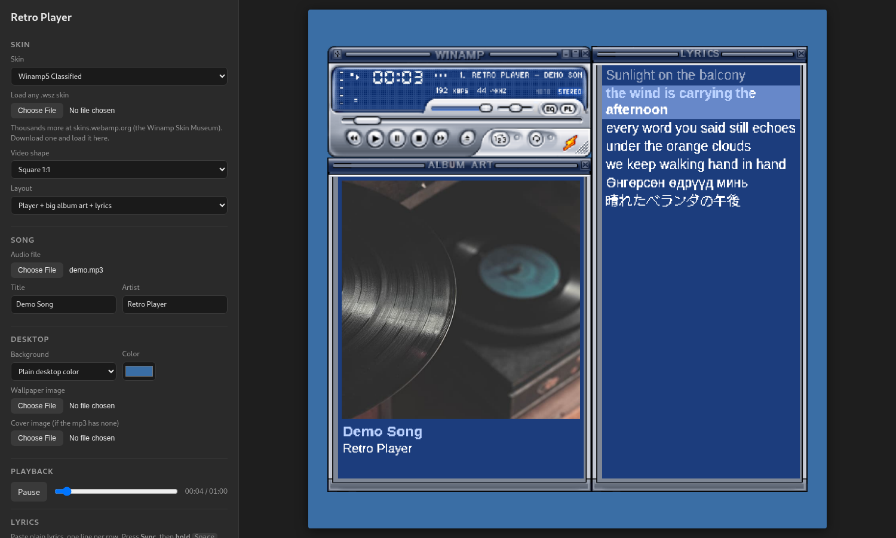

# Retro Player

Make music videos that look like an early-2000s desktop: a real Winamp skin, a big album art
window and karaoke-style synced lyrics. Built for posting songs on Instagram (square, wide or
Reels), but works for anything.



The player is [Webamp](https://github.com/captbaritone/webamp), so the skins are real `.wsz`
files from the 2000s. The album art and lyrics windows are built from the same skin's own
images and colors, so everything matches.



## Features

- Real Winamp skins: 9 included, or load any of the thousands at [skins.webamp.org](https://skins.webamp.org)
- Video shapes: square 1:1, wide 16:9, tall 9:16 (Reels), each with its own layout
- Synced lyrics with a highlight that follows the singing
- Hold-to-sync: hold Space while a line is sung, let go when it ends
- Pronunciation helper: show romaji (or anything) while syncing lyrics in a language you can't read
- Latin, Cyrillic (incl. Mongolian) and Japanese lyrics, in pixel-style text that matches the skin
- Reads title, artist and cover art from mp3 tags
- Records the video, then puts the original song audio on it (lined up automatically),
  with fade in/out and a sound level that matches the player
- Saves an Instagram-ready H.264 mp4 to `~/Videos/retro-player/`

## Requirements

Linux with `chromium`, `python3` + `numpy`, and `ffmpeg`.

## Use

```sh
./run.sh
```

1. Pick a video shape, layout and skin.
2. Load an audio file.
3. Paste the lyrics (one line per row), press **Sync**, and hold Space while each line is sung.
   **Save .lrc** keeps the timings; **Load .lrc** brings them back.
4. Set From / To and the fades, press **Record video**. The window goes fullscreen and records;
   Esc cancels. When it's done the status line shows where the mp4 was saved.

`run.sh` starts `server.py`, a small local helper that serves the page and builds the final
video with ffmpeg. Nothing is uploaded anywhere.

If the helper isn't running you still get the raw recording, and `./convert.sh <file>` turns it
into an mp4.

Note: Winamp skin fonts only have Latin letters, so non-Latin titles show blank in the small
scrolling display of the main window. The album art and lyrics windows show them fine.

## Credits

Webamp, the skins and the font belong to their authors; see [CREDITS.md](CREDITS.md).
The project's own code is MIT licensed, see [LICENSE](LICENSE).
